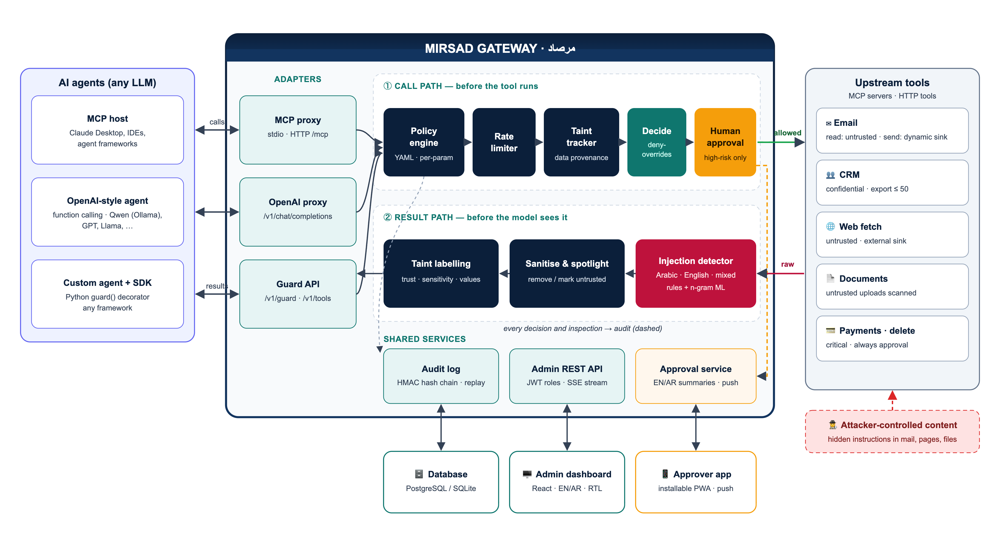

# Mirsad | مرصاد

**A runtime security firewall for AI agents against prompt-injection attacks.**

Mirsad sits between an LLM agent and the tools it uses (email, CRM, web, documents, payments). Every tool
call is checked against the organisation's policy before it runs, and every tool result is inspected before
the model sees it. Risky actions wait for a human decision on a phone, and every step is written to a
tamper-evident audit log.

IS499 Senior Project · Prince Sultan University · College of Computer & Information Sciences ·
Supervisor: Dr. Omaia Al-Omari



## Why

Agents read untrusted content (incoming email, web pages, uploaded files) and can act on it. Instructions
hidden in that content can redirect an agent into leaking data or taking actions its user never asked for
(OWASP LLM01, indirect prompt injection). Mirsad does not try to make the model immune; it controls what
the model's tool calls are allowed to achieve, in Arabic and English.

## Features

| Layer | What it does |
|---|---|
| Policy engine | Declarative YAML: per-agent, per-tool and per-parameter constraints (`max`, `pattern`, `domain_in`, …), rate limits, global rules, default-deny, monitor mode, hot reload with versions |
| Taint tracking | Labels results by trust and sensitivity, records where values came from, and escalates or blocks untrusted or confidential data flowing to external destinations |
| Injection detector | Arabic (MSA, Gulf, Arabizi, mixed) and English: Unicode/Arabic normalisation, weighted rules, an n-gram model (when trained) and sanitising or spotlighting of untrusted content |
| Human approval | Plain-language bilingual summaries, live updates and Web Push to an installable approver app (PWA), fail-safe expiry |
| Audit | HMAC-SHA-256 hash chain, secret and personal-data redaction, verification, decision replay, CSV/JSON export |
| Integrations | MCP proxy (stdio and streamable HTTP), OpenAI-compatible `/v1/chat/completions` proxy, Guard API and Python SDK |
| Dashboard | Overview, activity and audit log, approvals, policy editor, agents, users, tools, detector playground, demo console; English and Arabic (RTL), light and dark |

## Quick start

Requirements: Python 3.11+, Node 20+ (only to rebuild the web UI; a prebuilt UI ships in `src/mirsad/static`),
and optionally [Ollama](https://ollama.com) with `qwen2.5:7b` for the demo agent.

```bash
./scripts/setup.sh          # creates .venv and installs everything
./scripts/run_demo.sh       # creates demo users + agent, starts http://127.0.0.1:8700
```

The generated credentials are written to `.mirsad/credentials.txt` (mode 600) and are never printed.
Open the dashboard at `http://127.0.0.1:8700/` and the approver app at `http://127.0.0.1:8700/approve`.

Docker (gateway + PostgreSQL): copy `.env.example` to `.env`, set the secrets, then `docker compose up -d`.

## Put Mirsad in front of an agent

* **MCP host** (e.g. Claude Desktop): run `mirsad mcp-proxy --agent-key <key> --url http://127.0.0.1:8700`
  as the MCP server command, or connect an MCP client to `http://127.0.0.1:8700/mcp` with the agent key.
* **OpenAI-compatible agent**: point the client's `base_url` at `http://127.0.0.1:8700/v1` and use the
  Mirsad agent key; the upstream model is configured with `MIRSAD_LLM_BASE_URL`.
* **Any framework**: use the Python SDK.

```python
from mirsad.sdk import MirsadClient

mirsad = MirsadClient("http://127.0.0.1:8700", api_key="mk_...")

@mirsad.guard
def send_email(to: str, subject: str, body: str) -> dict:
    ...  # runs only if Mirsad allows the call; the returned value is the inspected result
```

See [docs/integration.md](docs/integration.md) and [docs/api.md](docs/api.md).

## Repository layout

| Path | Contents |
|---|---|
| `src/mirsad/` | Gateway, policy, taint, detector, audit, approvals, auth, adapters, SDK, REST API, CLI, built web UI |
| `web/` | React + TypeScript source of the dashboard and approver PWA |
| `configs/` | Policies (`default.yaml`, `strict-banking.yaml`, `monitor.yaml`) and upstream tool servers |
| `demo/` | Simulated Najd Trading Co. workspace (MCP server) and the demo LLM agent |
| `bench/` | Mirsad-Bench harness, benign scenarios (English and Arabic), latency benchmark |
| `data/detector/` | Detector dataset location and schema (team-supplied data) |
| `tests/` | Unit, integration, API, end-to-end, security (STRIDE) and PostgreSQL tests |
| `docs/` | Design docs, diagrams, research, report sources; `deliverables/` holds the generated documents |

## Quality and evaluation

```bash
make test        # Python test suite with coverage
make security    # Bandit, pip-audit, npm audit
make bench       # Mirsad-Bench benign runs for every defence configuration
make latency     # added latency over HTTP
./scripts/run_evidence.sh   # regenerate all evidence and reports/results_summary.json
```

Current measured results are collected in `reports/results_summary.json`. The detector's F1 score and the
attack-success-rate evaluation require attack-labelled data, which the team supplies under
`data/detector/raw/` and `bench/scenarios/attacks/` (see `docs/detector.md` and
`bench/scenarios/attacks/README.md`); then run `make detector` and `make bench`.

## Team

Mohammed Yasser Alanssari · Bader Alshuraie · Bader Abdullah Abbod Alyamini · Abdulmalik bin Saedan ·
Abdullah Naif Abdullah Al-Orabi

## Licence and disclosure

Apache-2.0 (see `LICENSE` and `NOTICE`). An AI coding and writing assistant (Anthropic's Claude) was used
during development; see Section 3.6 of the final report for the full disclosure.
