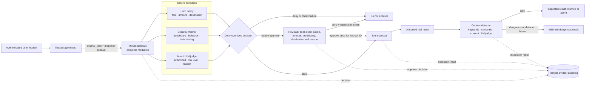

# Security-upgrade architecture

This diagram shows the enforcement path used by the Finance, Healthcare and general agents. The unprotected demo path exists only as a comparison control; production adapters use `Gateway.execute`.

## Why there are two LLM judges

- The **intent judge** runs before a state-changing action. It compares the proposed tool call with the authenticated original user request and returns structured fields: authorization, confidence, risk level and reason.
- The **content judge** runs after a read tool returns untrusted text. It looks for instructions hidden inside invoices, patient notes, email, documents or web pages.

They can use the same local `qwen2.5:7b` model, but they answer different security questions. Hard policy still has final authority; an LLM cannot override a deny rule.

## Approval security properties

1. The request is bound to one `call_id`, tool and argument set.
2. The reviewer sees the exact decision-critical fields; secrets and unrelated personal fields remain redacted.
3. A conditional database transition allows only one decision to win.
4. The approval expires after 300 seconds and a late click is rejected.
5. A new call, even with identical arguments, needs a new approval.
6. The audit chain records request, decision and execution outcome.
