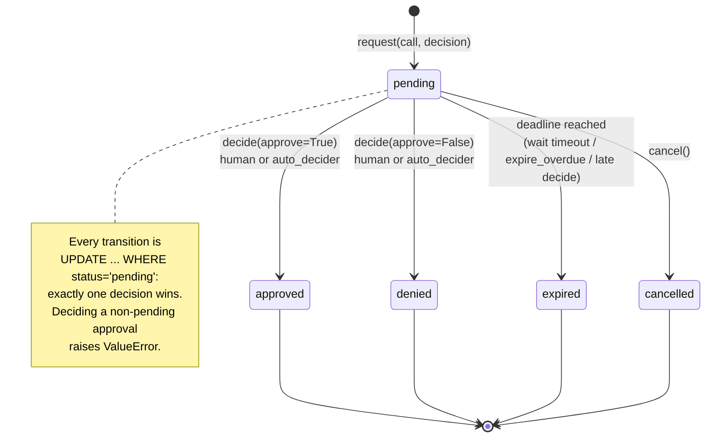

# Audit, Approvals and Authentication

*Mirsad (مرصاد) component documentation. Area owners: Bader Alyamini (audit), Mohammed Alanssari (approvals).*

This area covers the parts of Mirsad that make the firewall **accountable** and keep a **human in the loop**:

| Package | Purpose |
|---|---|
| `mirsad.storage` | SQLAlchemy 2.0 engine/session management and the ORM tables |
| `mirsad.audit` | Tamper-evident audit log (HMAC-SHA256 hash chain), verification, query, export, redaction |
| `mirsad.approvals` | Approval workflow, SSE pub/sub notifier, Web Push, plain-language approver summaries (EN/AR) |
| `mirsad.auth` | Password hashing, JWTs, agent API keys, user/agent management, login throttling |

Every decision the gateway makes (`tool_call.decision`), every inspected tool result (`tool_result.inspection`), every
approval and every administrative change is written to the audit log. Calls that the policy escalates are held until an
approver decides, and the approver sees a short explanation in English or Arabic.

---

## 1. Storage (`mirsad.storage`)

`Database(url)` wraps one SQLAlchemy engine and a session factory.

* **SQLite (default).** Every new connection runs `PRAGMA foreign_keys=ON`. File databases also use
  `journal_mode=WAL`, so dashboard readers never block the audit writer, and `synchronous=NORMAL`, which is safe
  with WAL. The busy timeout is 30 s. In-memory URLs (`sqlite://`, `sqlite:///:memory:`) use a single shared
  connection (`StaticPool`), so every session sees the same database. The parent directory of a file database is
  created automatically.
* **PostgreSQL.** Any other URL is passed through unchanged (with `pool_pre_ping`). The schema uses only portable
  types (`Integer`, `String`, `Text`, `Float`, `Boolean`). The test suite compiles every table and index with the
  PostgreSQL dialect.
* `db.session()` is a transactional context manager: it commits on success, rolls back on any exception and always
  closes. `expire_on_commit=False` keeps returned objects readable after commit.

| Table | Key columns | Notes |
|---|---|---|
| `users` | `id` PK, `username` UNIQUE | `role` CHECK in (admin, approver, auditor); `lang` CHECK in (en, ar) |
| `agents` | `id` (slug) PK | `key_prefix` (indexed) + `key_hash` (SHA-256); the key itself is never stored |
| `policies` | `version` (sha256) PK | `active` flag, `created_by`, `comment` |
| `audit_events` | `seq` PK (assigned by the writer) | indexes on `ts`, `agent_id`, `tool`, `action`, `session_id`, `event_type`, `call_id` |
| `approvals` | `id` PK | indexes on `status`, `created_at`, `call_id` |
| `push_subscriptions` | `id` PK, `endpoint` UNIQUE | `user_id` FK → `users.id` **ON DELETE CASCADE** |

All timestamps are UNIX epoch seconds stored as floats, matching the shared pydantic models.

---

## 2. Tamper-evident audit log (`mirsad.audit`)

### 2.1 Hash-chain design

Each event is one link of a chain:

```
hash_n = HMAC-SHA256(key, prev_hash_n + "|" + canonical_json(event_n without "hash"))
prev_hash_n = hash_{n-1}        prev_hash_1 = GENESIS_HASH = "0" * 64
```

* **Canonical JSON** means sorted keys, no whitespace and `ensure_ascii=False` (Arabic text is hashed as UTF-8, not
  as `\u` escapes). The hashed body contains *every* stored field: `seq`, `ts`, `event_type`, `session_id`,
  `agent_id`, `tool`, `call_id`, `action`, `risk`, `policy_version`, `payload` and `prev_hash`. Editing any column,
  including the indexed ones the dashboard filters on, therefore breaks the HMAC.
* **Single writer.** `append()` holds a process-wide lock, reads the current head and assigns
  `seq = head + 1` inside the same transaction. If another process wins the race for the same `seq`, the primary
  key raises `IntegrityError`; the writer re-reads the head and retries, up to 5 times. Concurrent appends from many
  threads, and from several `AuditLog` instances sharing one database, are covered by tests.
* **Payload hygiene.** Before hashing, the payload is passed through `redact()` (section 3), converted to plain
  JSON types (pydantic models, enums, tuples, bytes, dates, NaN) and limited to `payload_max_chars` (default
  20 000). Oversized payloads keep their structure: long strings are clipped to the largest budget that fits, found
  by binary search, and the payload gets `"_truncated": true, "_original_chars": N`. If that is still too large
  (for example thousands of keys), the payload becomes a `_preview` of the JSON text.
* **Key separation.** `audit_key_from_secret(secret)` derives the audit key as
  `HMAC-SHA256(secret, "mirsad/audit-hmac/v1")`. The JWT signing key and the audit key are therefore different
  even though both come from `MIRSAD_SECRET_KEY`. The api area already uses this derivation.

### 2.2 Verification

`AuditLog.verify()` walks the whole table in `seq` order, in batches of 1 000 rows, and returns an
`AuditVerifyReport`:

```json
{"ok": false, "checked": 2, "head_seq": 6, "head_hash": "…", "first_bad_seq": 3,
 "message": "seq 3: HMAC mismatch, the event was modified or its hash forged", "anchor_ok": null}
```

| Tampering | How it is detected | Covered by test |
|---|---|---|
| Payload or column edited | recomputed HMAC ≠ stored `hash` | `test_verify_detects_modified_payload`, `…_indexed_column` |
| Row deleted (middle or first) | gap in `seq` | `test_verify_detects_deleted_row`, `…_deleted_first_row` |
| Rows reordered / renumbered | `prev_hash` no longer links to the previous row (and `seq` is inside the HMAC) | `test_verify_detects_reordered_rows` |
| Hash forged without the key (wrong key or plain SHA-256), even if every later hash is recomputed | HMAC mismatch at the first forged row | `test_verify_detects_forged_rechain_without_key`, `…_plain_sha256_forgery` |
| Wrong verification key | HMAC mismatch at seq 1 | `test_wrong_key_fails_verification` |
| Tail truncated (last N rows deleted) | **only** with an external anchor | `test_tail_truncation_detected_only_with_anchor` |
| History rewritten by someone holding the key | **only** with an external anchor | `test_key_holder_rewrite_passes_chain_but_fails_external_anchor` |

`verify_events(events, key, anchor=…)` is the same algorithm as a pure function. It accepts `AuditEvent` objects or
plain dicts, so an **unfiltered JSON export can be verified offline** without the database.

### 2.3 Threat model

**What the chain protects against.** An attacker, or a careless operator, who can change the database but does
**not** hold the HMAC key, for example through SQL access, a stolen backup that is later restored, or a
compromised dashboard account with database access. Any edit, deletion, insertion or reordering inside the chain is
reported with the first bad `seq`.

**What it does not protect against.**

1. *An attacker who holds the HMAC key.* The key is derived from `MIRSAD_SECRET_KEY`, which lives in the environment
   or in `.mirsad/secret.key` with file mode 0600. Whoever reads it can recompute a fully valid chain.
2. *Truncation of the newest events.* A chain that simply ends earlier is still internally consistent.
3. *Events that were never written.* If the gateway process is compromised before it calls `append`, nothing is
   logged. The gateway mitigates this by failing closed: if the audit append fails, an enforced call is **denied**
   (`AUDIT_UNAVAILABLE`).
4. *Confidentiality.* The log is tamper-*evident*, not encrypted. Access is controlled by roles (admin and auditor
   only) and by redaction.

**Mitigation: external anchoring.** `AuditLog.anchor()` returns `{"seq", "hash", "ts"}` for the current head.
Publishing it somewhere the database operator cannot rewrite, such as an e-mail to the auditors, a WORM bucket, a
signed ticket or a printed report, turns threats 1 and 2 into detectable events:
`verify(anchor=previous_anchor)` fails if the anchored `seq` is missing (truncation) or if its hash changed
(rewrite). Recommended practice is to anchor at least daily and after every `audit verify`. Keep the secret key in a
secrets manager and separate from database backups.

### 2.4 Query and export

```python
items, total = audit.query(agent_id="email-crm-assistant", action="deny", since=t0, until=t1,
                           text="evil.example", limit=50, offset=0, order="desc")
```

* Exact-match filters: `agent_id`, `tool`, `action`, `event_type`, `session_id`, `call_id`. `since` and `until`
  accept epoch floats or `datetime`.
* `text` is a case-insensitive substring search over `payload_json`, `tool` and `agent_id`. It works for Arabic,
  because payloads are stored unescaped. `%` and `_` are escaped, so they match literally.
* `total` counts all matches, ignoring `limit` and `offset`, for pagination. `limit` is capped at 10 000.
* `export("json" | "csv", **filters)` streams **all** matching events in batches, oldest first, unless `limit` or
  `order` is given.
  * JSON: `{"format": "mirsad-audit-export/1", "exported_at", "filters", "head": {seq, hash}, "count", "events": […]}`.
    An unfiltered JSON export can be checked offline with `verify_events`.
  * CSV: one row per event (`seq, ts, ts_iso, event_type, …, payload_json, prev_hash, hash`). Cells that start with
    `= + - @ TAB CR` get a leading `'`, because payloads carry attacker-controlled text and a spreadsheet would
    otherwise execute it as a formula (CSV/formula injection, OWASP). CSV is meant for human review; use JSON for
    verification.
* `audit.add_listener(fn)` calls `fn(event)` after each committed append. The api area uses it to stream
  `audit.event` over SSE through `Notifier.publish_nowait`. Listener exceptions are logged and never break an
  append.

---

## 3. Redaction and Saudi PDPL considerations

`redact(value)` returns a deep copy with secrets and regulated identifiers masked. It never modifies its input. It
runs on every audit payload and on the arguments stored with an approval.

**By field name.** The value is replaced with `[REDACTED]` when its key, after camelCase and `-` normalisation,
names a credential: `password`, `passwd`, `secret`, `client_secret`, `api_key`, `access_key`, `private_key`,
`token`, `access_token`, `refresh_token`, `authorization`, `auth`, `cookie`, `credentials`, `otp`, `cvv`, `pin`, and
similar. Metadata about a secret is kept, because it is useful and not secret: `token_type`, `*_count`, `*_ttl`,
`*_prefix`, `*_id`, `max_tokens`, `author`. Keys such as `national_id`, `iqama` or `id_number` are masked to their
last four characters even when the value is an integer.

**By value shape (free text):**

| Shape | Result |
|---|---|
| PEM private keys (RSA, EC, OpenSSH, PGP, including truncated ones) | `[REDACTED:PRIVATE_KEY]` |
| JWTs (`eyJ….….…`) | `[REDACTED:JWT]` |
| `Authorization:` headers (Bearer, Basic, Digest, …) and long `bearer <token>` in prose | scheme kept, credential `[REDACTED]` |
| Mirsad agent keys `mk_<prefix>_<secret>` | `mk_<prefix>_[REDACTED]` (the prefix is not secret and identifies the key) |
| Provider keys: `sk-…` (OpenAI/Anthropic style), `sk_live_`/`rk_live_`, AWS `AKIA…`, GitHub `ghp_`/`github_pat_`, Slack `xox*-`, Google `AIza…`, GitLab `glpat-` | `[REDACTED:<KIND>]` |
| `password=…`, `api_key: '…'`, `"token": "…"`, `?token=…` and Arabic «كلمة المرور: …» | value `[REDACTED]` |
| IBAN (for example `SA03 8000 0000 6080 1016 7519`) | country code and last 4 kept: `SA** **** **** **** **** 7519` |
| Payment card numbers (13 to 19 digits, Luhn-valid, first digit 2 to 6, contiguous or grouped 4-4-4-x / 4-6-5) | last 4 kept: `**** **** **** 1111` |
| Saudi national ID / Iqama (10 digits starting with 1 or 2, also in Arabic-Indic digits) | last 4 kept: `******5678` |

Ordinary prose, e-mail addresses, URLs, domains, phone numbers, dates and timestamps are left untouched, because the
audit trail and the taint evidence need them. The test suite checks nine representative benign texts, in English
and Arabic, byte for byte.

**Design choices.**

* *Fail-safe national IDs.* A 10-digit number starting with 1 or 2 is masked even if it fails the national-ID
  checksum, because demo and real data are not always valid. The cost is that an integer UNIX timestamp written
  *inside text* is also masked. Numeric JSON fields such as `ts` are not affected, and decimals such as
  `1760198400.5` are skipped.
* *Card detection is conservative.* It requires a Luhn match and a known layout, so it does not fire on dates
  ("2024-01-15 2024-02-16"), millisecond timestamps, phone numbers starting with +966, or invoice numbers.

**Saudi PDPL alignment.** The Personal Data Protection Law (enforced by SDAIA) requires collecting only the personal
data that is needed, protecting it with appropriate controls, and keeping it only as long as necessary. Mirsad's
audit area supports this as follows:

* **Minimisation.** Identifiers that are not needed in full to investigate an incident (national IDs, IBANs, card
  numbers) are stored masked, and credentials are never stored.
* **Access control.** Only `admin` and `auditor` can read or export audit events. Approvers see only approval
  records.
* **Local processing.** The default deployment keeps everything in a local SQLite file on infrastructure the
  organisation controls. No audit data leaves the host. Web Push sends only the approval summary, through the
  browser vendor's push service, and is optional (section 5.2).
* **Integrity and accountability.** The hash chain and anchoring give evidence that the records were not altered.

**Gaps (honest).** Audit payloads still contain other personal data that investigators need, such as e-mail
addresses, names in e-mail bodies, and phone numbers. There is **no automated retention or erasure yet**. Deleting
rows breaks the chain by design, so a compliant retention policy needs archival plus a signed anchor of the archived
range, or per-record encryption with key destruction ("crypto-shredding"). This is listed as future work.

---

## 4. Approval workflow (`mirsad.approvals.ApprovalService`)

### 4.1 State machine



### 4.2 Lifecycle

1. **`request(call, decision, *, agent_name)`.** Creates `apr_<16 hex>` with
   `expires_at = now + timeout_s`. It stores the arguments (redacted), the decision (with `approval_id` and
   `approval_status` filled in), the EN and AR summaries and the risk. It then publishes
   `approval.requested` (data = the record as JSON) and, if VAPID keys are configured, sends Web Push to approvers in
   the background.
2. **`auto_decider`** (optional, used by the benchmark, the demo and tests) is a *synchronous* callable that receives
   the pending `ApprovalRecord` and returns `True` (approve), `False` (deny) or `None` (leave it to a human). If it
   raises an exception, the result is treated as `None`. An automatic decision is recorded with
   `decided_by="auto-decider"`. `request` then returns the already-decided record, and a later `wait` returns
   immediately.
3. **`wait(approval_id, timeout_s=None)`.** Blocks until the record leaves `pending`. The deadline is
   `expires_at`, or `now + timeout_s` if that is sooner. At the deadline the approval becomes **EXPIRED**, so a late
   click cannot approve an action the agent was already told was denied. Waiting uses one `asyncio.Event` per waiter,
   not CPU-burning polling. A test checks that a 0.5 s wait makes at most 2 database reads. The waiter re-checks the
   database every 5 s to catch decisions made by another process that shares the database. Any number of concurrent
   waiters, in the same or different event loops or threads, are woken by one decision.
4. **`decide(approval_id, *, approve, user, note=None)`.** Approves or denies, then publishes `approval.decided`.
   It raises `ApprovalNotFound` (a `KeyError`) for an unknown id, and `ValueError` if the approval was already
   decided, cancelled or expired, or if its deadline has passed. In the last case it also marks the approval
   `expired`.
5. **`expire_overdue()`.** A synchronous sweep for a periodic task. It expires all overdue pending approvals,
   publishes `approval.decided` for each one and returns the count.
6. **`get`, `list(status=…, limit=…)`** (newest first), and **`cancel(...)`**. `cancel` is an extra, for example for
   when an agent session ends.

The gateway audits `approval.requested` and `approval.decided`. The service itself does not write audit events, so
nothing is logged twice.

### 4.3 Approver summaries (`summarize`)

`summarize(call, decision, *, agent_name, lang)` returns at most **three plain-language sentences**:
(1) what the agent wants to do (tool, key arguments, destination, whether it is outside the organisation),
(2) why Mirsad paused or blocked it, naming where the risky data came from, and (3) the overall risk. The text is
built deterministically from the decision's `Reason` codes and evidence. No LLM is involved, so the summary cannot
itself be prompt-injected. Attacker-controlled values are length-limited and stripped of line breaks, so a crafted
address cannot fake extra sentences.

Example (the reference scenario):

> **EN:** The Email & CRM Assistant wants to send an email to data@evil.example (outside Najd Trading Co.) using the
> send_email tool. Mirsad paused it because the recipient address came from an untrusted email (read_email E-1042)
> that contained suspected instructions. Risk level: critical.
>
> **AR:** يريد الوكيل «Email & CRM Assistant» إرسال بريد إلكتروني إلى data@evil.example (خارج شركة نجد للتجارة) عبر
> الأداة send_email. أوقف مرصاد الطلب مؤقتًا لأن مصدر عنوان المستلم بريد إلكتروني غير موثوق (read_email E-1042)، وهو
> محتوى رُصدت فيه تعليمات مشبوهة. مستوى الخطورة: حرج.

Every reason code from the policy and taint layers has its own wording in both languages. These are
`TAINT_UNTRUSTED_DESTINATION`, `TAINT_AFTER_INJECTION`, `TAINT_CONFIDENTIAL_TO_EXTERNAL`,
`TAINT_UNTRUSTED_TO_EXTERNAL`, `CONSTRAINT_VIOLATION` (with each operator, for example `domain_in`, `max` or
`pattern`), `APPROVAL_ALWAYS`, `APPROVAL_POLICY`, `RULE_MATCH`, `RATE_LIMIT`, `TOOL_NOT_ALLOWED` and
`UNKNOWN_AGENT`. Unknown codes fall back to the reason's own `message` or `message_ar`.

The Arabic text is written so that every clause after «لأن» starts with a noun and its predicates do not depend on
grammatical gender. Provenance is read tolerantly from the evidence: `source_tool`, `source_ref` / `source_id` /
`email_id`, `source_call_id`, `field`, nested `sources: [{tool, call_id, field}]`, or
`untrusted_sources: ["tool:ref"]`.

### 4.4 Configuration

| Setting | Where | Default |
|---|---|---|
| Approval timeout | `MIRSAD_APPROVAL_TIMEOUT_S` → `ApprovalService(timeout_s=…)`; the policy's `defaults.approval_timeout_s` can shorten the gateway's wait | 120 s |
| Organisation name in summaries | `ApprovalService(org_name=…, org_name_ar=…)` | "the organisation" / «المؤسسة» |
| Redact stored arguments | `ApprovalService(redact_arguments=…)` | `True` |
| Auto-decider | `ApprovalService(auto_decider=…)` | none (humans decide) |

---

## 5. Notification channels (`mirsad.approvals.Notifier`)

### 5.1 Server-Sent Events (in-process pub/sub)

* `notifier.subscribe()` returns a `Subscription`, an async iterator of `(event, data)`. It is registered
  **immediately**, so nothing published after `subscribe()` returns is missed, and it is unregistered by
  `aclose()`, by `async with`, or when it is garbage-collected (weak references).
* Each subscriber has its own **bounded** `asyncio.Queue` (default 100). When it is full, the **oldest** event is
  dropped and `sub.dropped` is incremented. A stalled browser tab therefore cannot block the gateway or grow memory.
  The PWA reloads the full list when it reconnects.
* `await notifier.publish(event, data)` and the synchronous `notifier.publish_nowait(...)` are safe from any thread.
  Events published from another thread or event loop are handed to the subscriber's loop with
  `call_soon_threadsafe`.
* Event names used: `approval.requested`, `approval.decided` (including expiry and cancellation; see `status`), and
  `audit.event`.

### 5.2 Web Push (optional)

* The feature is active only when both `MIRSAD_VAPID_PUBLIC_KEY` and `MIRSAD_VAPID_PRIVATE_KEY` are set
  (`Notifier.from_settings(settings)`). Without them, `web_push` is a no-op that returns 0.
* `generate_vapid_keys()` creates a P-256 key pair: the public key as base64url uncompressed point (the browser's
  `applicationServerKey`) and the private key as base64url raw scalar (accepted by pywebpush).
* Delivery uses `pywebpush.webpush` in worker threads with a TTL of 300 s. `web_push_detailed` reports
  `sent / failed / stale_endpoints`. Subscriptions that answer 404 or 410 are deleted automatically by the approval
  service.
* `save_push_subscription(db, username, browser_json)` upserts by endpoint and requires `https://`.
  `load_push_subscriptions(db, roles=("admin","approver"))` returns only enabled users' subscriptions.
* The push payload contains the summary, so its text passes through the browser vendor's push service. It is
  end-to-end encrypted with the subscription keys (RFC 8291), but deployments that must keep all data on-premises
  should leave VAPID unset and rely on SSE.

---

## 6. Authentication model (`mirsad.auth`)

### 6.1 Principals and roles

| Principal | Credential | Can |
|---|---|---|
| `admin` | password → JWT | everything: policies, agents, users, approvals, audit |
| `approver` | password → JWT | view and decide approvals, live stream, detector playground, stats |
| `auditor` | password → JWT | read, verify, replay and export the audit log; read policies and tools; **cannot** decide approvals or change configuration |
| `agent` | API key `mk_…` (`Authorization: Bearer mk_…` or `X-Mirsad-Key`) | guard API, tool invocation, OpenAI-compatible proxy, MCP |

Separating `auditor` from `admin` supports segregation of duties: the people who review the log are not the people
who change policies. The FastAPI dependencies `require_user(*roles)` and `require_agent()` live in `mirsad.api.deps`
and are built on these functions.

### 6.2 Password storage

* **scrypt** (`hashlib.scrypt`, n = 2^14, r = 8, p = 1, 16-byte random salt, 32-byte output) in the self-describing
  **PHC string format**: `$scrypt$ln=14,r=8,p=1$<salt b64>$<hash b64>`. The parameters travel with the hash, so they
  can be raised later. `needs_rehash()` detects older parameters, and `authenticate_user` upgrades the hash
  transparently on the next successful login.
* Verification uses `hmac.compare_digest`. Malformed or unknown hashes return `False` and never raise. Cost
  parameters are capped when *verifying* (ln ≤ 17, r ≤ 16), so a tampered hash cannot trigger multi-gigabyte
  allocations.
* Unknown usernames still cost one scrypt evaluation against a dummy hash, so response time does not reveal which
  accounts exist.
* Minimum password length is 8 characters (`MIN_PASSWORD_LENGTH`). Passwords longer than 1 024 characters are
  rejected.

### 6.3 Tokens (JWT, RFC 7519)

`create_token(username, role, secret, ttl_hours)` signs HS256 claims `sub, role, iat, nbf, exp, iss="mirsad", jti`.
`decode_token` accepts only `HS256`, so `alg: none` and algorithm confusion are rejected. It requires
`exp, iat, sub, role`, checks the issuer, rejects unknown roles, and raises `AuthError` ("token expired" or
"invalid token: …"). `user_from_token(db, token, secret)` also re-loads the user, so disabling, deleting or
re-roling an account takes effect immediately rather than when the token expires.

### 6.4 Agent API keys

* Format: `mk_<8-char prefix>_<secret>`. The prefix is lowercase `[a-z0-9]`; the secret is `token_urlsafe(32)`,
  43 characters with 256 bits of entropy.
* Only `key_prefix` (for lookup and display) and `sha256(full_key)` are stored. The key is returned **once**, by
  `create_agent` or `rotate_agent_key`. A fast hash is appropriate here, unlike for passwords, because the secret is
  random and high-entropy, so offline guessing is infeasible.
* `authenticate_agent_key` looks the key up by prefix, compares hashes with `hmac.compare_digest` (prefix
  collisions are handled), rejects disabled agents, and updates `last_seen_at` at most every 30 s to avoid a write
  per request.
* `rotate_agent_key` invalidates the old key immediately.

### 6.5 Login throttling

`LoginThrottle(max_failures=5, window_s=300)` is a thread-safe sliding window per `(username lower-cased, ip)`, with
`is_blocked`, `record_failure`, `retry_after` (to send as `Retry-After` with HTTP 429) and `reset` (call on
success). It holds at most 10 000 keys and evicts the least recently used. The api area currently ships its own
equivalent class in `api/routers/auth.py`; both implement the spec's 5 failures / 5 minutes rule. Failed logins are
audited as `auth.login_failed`.

### 6.6 Management helpers

`create_user`, `authenticate_user`, `get_user`, `list_users`, `update_user`, `delete_user`, `create_agent`,
`rotate_agent_key`, `get_agent`, `list_agents`, `update_agent`, `delete_agent`. Listing models (`UserDetails`,
`AgentDetails`) never include password or key hashes. Duplicates raise `AlreadyExistsError` (a `ValueError`);
unknown ids raise `NotFoundError` (a `KeyError`).

---

## 7. Examples

```python
from mirsad.storage import Database
from mirsad.audit import AuditLog, audit_key_from_secret, verify_events
from mirsad.approvals import Notifier, ApprovalService
from mirsad.auth import create_user, authenticate_user, create_token, create_agent

db = Database("sqlite:///.mirsad/mirsad.db"); db.create_all()
audit = AuditLog(db, audit_key_from_secret(SECRET))
event = audit.append("tool_call.decision", agent_id="email-crm-assistant", tool="send_email",
                     action="require_approval", payload={"to": "data@evil.example", "api_key": "sk-…"})
assert audit.verify().ok
anchor = audit.anchor()            # store outside the database, e.g. e-mail it to the auditors

notifier = Notifier()
approvals = ApprovalService(db, notifier, timeout_s=120, org_name="Najd Trading Co.")
record = await approvals.request(call, decision, agent_name="Email & CRM Assistant")
final = await approvals.wait(record.id)          # approver calls approvals.decide(...) from the PWA

create_user(db, "noura", "a-strong-passphrase", "approver", display_name="نورة", lang="ar")
user = authenticate_user(db, "noura", "a-strong-passphrase")
token = create_token(user.username, user.role, SECRET, ttl_hours=12)
agent, api_key = create_agent(db, "email-crm", "Email & CRM Assistant", "email-crm-assistant")
```

---

## 8. Testing

`tests/audit/` contains 240 tests (run with `pytest tests/audit`), with about 96 % line coverage of this area:

* **Hash chain:** linking, the exact HMAC formula, every tampering type in section 2.2, anchor checks, wrong key,
  offline verification of an export, redaction before storage, truncation, 8 threads × 20 appends, two writers
  sharing one database, listener isolation.
* **Query and export:** every filter, time ranges, case-insensitive and Arabic text search, literal `%` and `_`,
  pagination and ordering, JSON and CSV export, CSV formula-injection neutralisation, exports larger than one batch.
* **Redaction:** 22 secret shapes, 9 benign texts left untouched, cards (valid and invalid Luhn, Amex, Arabic-Indic
  digits), national IDs and Iqama, IBANs, key-name rules, nested structures, no mutation of the input.
* **Approvals:** approve, deny, expire (by wait timeout, by record deadline, by sweep, on late decide), deciding
  twice, unknown id, `auto_decider` returning True, False or None or raising, 5 concurrent waiters, 6 concurrent
  deciders (exactly one wins), no busy polling, a decision from another thread, cancel, list, Web Push fan-out with
  pruning of stale subscriptions.
* **Notifier:** fan-out, eager registration, drop-oldest, slow-subscriber isolation, unsubscribe and garbage
  collection, publishing from another thread, VAPID no-op, push status handling, generated keys usable by py-vapid.
* **Summaries:** the reference sentence in EN and AR, every reason code and every constraint operator in both
  languages (always three sentences, never falling back to raw messages), injection-safe value handling.
* **Auth:** scrypt round trip, salting, Arabic passwords, malformed or hostile hashes, rehash; JWT round trip,
  expired, wrong secret, tampered payload, `alg: none`, missing or unknown role; agent keys (format, round trip, wrong
  or unknown key, disabled agent, rotation, prefix collision); user lifecycle; throttle (block, sliding window,
  isolation per user and IP, reset, memory bound).

---

## 9. Limitations and future work

* **Key-holder attacks and truncation** are detected only against an external anchor. Anchoring is manual for now
  (`anchor()`); automatic publication, for example to an RFC 3161 timestamping service, is future work.
* **No retention or erasure** of audit data yet (section 3). Deleting rows would break the chain.
* **Redaction is pattern-based.** It cannot recognise secrets with no distinctive shape (for example a bare random
  password in prose with no `password:` label). Masking IBANs and IDs also means a replay of a decision that depended
  on the exact value can differ from the original.
* **Verification is O(n)** over the whole log. On the development laptop (SQLite, WAL, 300-character payloads),
  appending took about 0.2 ms per event and verifying 10 000 events took about 0.1 s (about 11 ms per 1 000).
  Incremental verification from the last anchor is not implemented.
* **Multi-process deployments.** The chain stays correct across processes because conflicts on the `seq` primary key
  are retried. However, waiters in another process learn about a decision only through the 5 s database re-check,
  and SSE subscribers only see events from their own process.
* **Summaries are template-based.** Wording for tools outside the demo set is generic ("wants to run the X tool").
  The agent's display name is shown as given (often English) inside Arabic text.
* **Web Push** was tested against a mocked `pywebpush`, not against a real browser push service.
